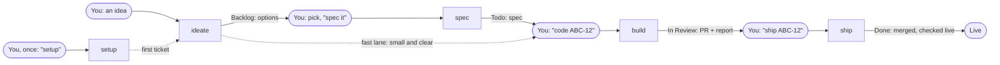

# sdlc-fede

A lean software factory for solo builders and small teams. Six agent skills: `setup` readies a project once, and five carry a ticket from a spoken idea to a merged pull request. The Linear issue is the thread, sessions are disposable, and you step in at most four times per ticket.

Built for people who do not want enterprise process but do want a process: no story points, no test-case tables, no retros. A loop, evidence for every claim, and agents that speak up about what needs your attention.

## The loop



You speak four times. Everything in between is an agent working alone, in the cloud or on your machine. Every status where the issue rests is your turn.

| You say | Skill | The agent does alone | On the issue | Status after |
|---|---|---|---|---|
| An idea, by voice is fine | `ideate` | Visual read-back at once, then explores and prepares options | Idea, flow, attention items, options, numbered decisions | Backlog |
| "1 B, 2 ok, option A. Spec it" | `spec` | Grounds the pick in the code, flags risks, sizes it, writes checks an agent can verify | The spec replaces the description; the options move to a comment | Todo |
| "Code ABC-12" | `build` | Branch, tests first, code, review, evidence for every check, pull request | A report with evidence, attention items and decisions | In Review |
| "Ship ABC-12" | `ship` | Checks it is ready, merges, watches the deploy, looks at the live result | A close-out with what is next and factory notes | Done |

When a ticket is small and clear, `ideate` takes the **fast lane** and files a ready-to-build spec, so you speak three times instead of four. When a feature is several tickets, `feature` runs them for you: it posts a plan, waits for your "go", then drives one build per sub-issue on a feature branch, verifies and integrates each, and hands you one pull request to ship.

## Install

With Claude Code 2.1.275 or later, one step:

```sh
claude plugin install factory --marketplace el-sapo/sdlc-fede --scope user
```

Or in two, which works on older versions too:

```sh
claude plugin marketplace add el-sapo/sdlc-fede --scope user
claude plugin install factory@sdlc-fede --scope user
```

Restart the session afterwards; skills are discovered at session start. The skills then answer to `/factory:setup`, `/factory:ideate`, `/factory:spec`, `/factory:build`, `/factory:ship` and `/factory:feature`, and to plain words such as "spec it", "code ABC-12", "ship ABC-12" and "build the feature ABC-47".

With Codex:

```sh
codex plugin marketplace add el-sapo/sdlc-fede
codex plugin add factory@sdlc-fede
```

Start a new Codex task afterwards so it discovers the skills.

With Cursor, add `https://github.com/el-sapo/sdlc-fede` as a marketplace in the plugin settings, then add `factory` from the `sdlc-fede` marketplace.

The Codex and Cursor manifests ship; the skills have been exercised with Claude Code.

### Where the skills load

A plugin installed on your machine loads in local sessions, including the ones you steer from your phone through Remote Control. Claude Code cloud sessions do not install plugins. Two ways to have the skills there:

- Save the six skills on your claude.ai account (open each `SKILL.md` under `plugins/factory/skills/` and add it as a skill). Account skills load in cloud, app and terminal sessions alike.
- Commit them into a repository's `.claude/skills/`, which loads in every session that opens that repository.

The plugin is for sharing the process with a team or a friend; your account or the repository is how the skills reach cloud sessions.

## What you need

- **Linear** with the default statuses (Backlog, Todo, In Progress, In Review, Done) and the GitHub integration on, so branches link to issues. Nothing custom.
- **GitHub** and a Linear connector in the sessions that run the skills.
- **Hosting that deploys on merge** and builds a preview per pull request, for `ship` to watch. Without it, `ship` says "merged, not deployed" and stops there.
- **An `AGENTS.md` in the repository** that says how to install, run, test and lint, and how the app deploys and where to check it live. The skills read it and follow it, and they name no platform of their own. Every agent obeys it, so `setup` only proposes it, as a pull request you merge; after that, keeping it right is yours.
- **A session that can run the project.** A cloud session cannot build native apps or grant device permissions; for those, run the session on your machine. The skills say what each situation leaves to you.

Say "setup" once in the repository and it checks the rest of this list for you, then says what is missing and where to fix it.

## The six skills

| Skill | Trigger | Job |
|---|---|---|
| [`setup`](plugins/factory/skills/setup/SKILL.md) | "setup" | Once per project, outside the loop: proves the install, run, test and lint commands by running them, checks Linear and every connection, proposes `AGENTS.md` as a pull request you merge, and reports ready or what is missing and where to fix it. Offers a first ticket. Never creates a repository, a team or hosting |
| [`ideate`](plugins/factory/skills/ideate/SKILL.md) | an idea | A visual brief you can steer from a phone, then two or three options on a Linear issue, or a ready spec on the fast lane |
| [`spec`](plugins/factory/skills/spec/SKILL.md) | "spec it" | A lean, buildable spec in the same issue: binary checks with how to verify them, real file names, a default for every open decision, sub-issues when it is more than one pull request |
| [`build`](plugins/factory/skills/build/SKILL.md) | "code ABC-12" | A pull request built carefully and unattended: tests first, a fresh reviewer, evidence per check, a report on the issue. Never merges |
| [`ship`](plugins/factory/skills/ship/SKILL.md) | "ship ABC-12" | Readiness checks, merge, watch the deploy, check it live, close out. One approval covers one pull request |
| [`feature`](plugins/factory/skills/feature/SKILL.md) | "build the feature ABC-47" | The orchestrator: a plan you approve, then one fresh worker per sub-issue on a feature branch, each verified and merged into it before the next, one final pull request, and the state on the parent so any session can continue |

### What agents are loud about

Every skill flags the same things, each as its own card with tags for complexity and risk of breaking: a behaviour change, a risk of breaking existing features or data, security and privacy, data that cannot be undone, a design problem, a new cost or dependency, a scope surprise, a shaky assumption. The test is whether you would be annoyed to learn it only after the build. Routine work gets no card.

### Where you are in the loop

| Issue rests in | You look at | Your word approves |
|---|---|---|
| Backlog | The options page: options, attention cards, numbered decisions | The direction |
| Todo | The spec in Linear, which you can edit | What gets built. This is where your time pays off most |
| In Review | The pull request, the preview, the report with evidence per check | The merge, which is also the deploy |
| Feature plan | Steps, worker and reviewers per step, where the run stops | How far the orchestrator goes |
| In Review, a feature | The final pull request and the "Feature built" report | The merge of the whole feature, which is the deploy |

Agents stop on their own for an irreversible operation, anything touching secrets or permissions beyond the spec, a discovery that changes what you approved, or a plan too broken to follow. They never merge during `build`, weaken a test to get to green, force a merge, deploy by hand, edit a repository's instructions file (`setup` only proposes it, as a pull request you merge), or commit specs and plans.

## Principles

- **The Linear issue is the thread.** Every run starts by reading the issue and ends by writing to it. Nobody has to find a chat again.
- **Pictures steer faster than paragraphs.** The first answer to an idea is a visual brief, laid out for a phone.
- **Depth follows the idea.** The agent decides how much to show and how to size the work.
- **Evidence, not claims.** A check has passed only when something was run and seen to pass. Checks only you can run are counted apart.
- **Only code is committed.** Specs stay in Linear, plans stay in ignored scratch folders.
- **Decide what you can, stop for what you must.** A question with a recorded default never blocks a build.

[docs/design.md](docs/design.md) has the full design: lanes, templates, what each step generates, and the decisions with what was rejected. [docs/setup.md](docs/setup.md) covers installing the plugin, connecting your accounts and running `setup`. [docs/factory-flow.en.html](docs/factory-flow.en.html) is an animated one-page explainer of the line, also in Spanish as [docs/factory-flow.es.html](docs/factory-flow.es.html); open it in a browser.

## Status

v0.4. The loop has run on real tickets: `ideate`, `spec` and `build` on a native macOS app and a multiplatform app, `feature` on a four-issue feature across two repositories. That first `feature` run is what moved it from stacked pull requests to a feature branch with one final pull request; the new shape has not run on a real feature yet. `ship` has not yet run against hosting that deploys on merge. Dry runs with fresh agents are how each skill was tested before that; `setup`, new in 0.4, has run only in dry runs so far. [docs/design.md](docs/design.md) says what is still untested and lists the known gaps, each with a workaround. Expect the skills to change as more tickets go through.

## Validate a checkout

```sh
python3 scripts/validate.py
claude plugin validate .claude-plugin/marketplace.json --strict
claude plugin validate plugins/factory --strict
```

The validator also checks that the Codex and Cursor manifests list the same plugin at the same version.

## Credits

The triage idea behind the fast lane and the orchestrator comes from [Warp Factories](https://www.warp.dev/blog/open-infrastructure-for-building-a-software-factory) and Zach Lloyd's talk on software factories.

## License

[MIT](LICENSE)
