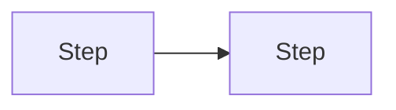

# Ideate

The user gives an idea in a short session, often by voice while away from the desk, and then leaves. The job has two parts: show quickly how you understood the idea, so they can correct you while they are still there, then work alone until the idea sits on a Linear issue, as options to choose from or, when it is small and clear, as a spec that is ready to build.

Four principles explain the rules below:

- **Pictures steer faster than paragraphs.** The user decides from diagrams, mockups and tables on a phone. A wall of text delays the correction that saves the most work.
- **Depth follows the idea.** You decide how much to show. A simple idea needs a sentence and one diagram. An idea with several moving parts earns more diagrams, a table, more sections. Add detail where a decision depends on it and cut it everywhere else.
- **Loud about what needs attention, quiet about the rest.** If everything is flagged, the user learns to ignore flags.
- **The Linear issue is the thread.** Nobody should have to reopen this session later. Anything worth keeping ends up on the issue; the chat is disposable.

## The brief: how to present anything

Whatever you show the user, at any step, is one visual page built from these parts. Use the parts the idea needs and scale each to its size.

1. **What.** The idea as you understood it, as short as it can honestly be, with overall tags for complexity and risk of breaking. Once there are options, the overall tags describe the recommended one.
2. **How it works.** Flow diagrams. Several small diagrams beat one dense one.
3. **What it looks like.** Grey-box mockups of new or changed screens: boxes and real labels, no styling. Skip this when there is no interface.
4. **Needs your attention.** One card per flagged item (next section).
5. **Decisions.** A numbered list of everything you need from the user, each with its options and your default, so they can answer by number ("1 B, 2 ok").

Build it as HTML: diagrams for flows and for before and after, tables for comparisons, and tags for `Complexity` and `Risk of breaking`, each low, medium or high and coloured green, amber or red. Always print the word on the tag, because colour alone is easy to miss. Complexity is low for about one pull request, medium for a few, and high when the work needs phasing or touches many areas. Lay the page out for a phone first, in one column.

Where it goes: for the read-back, the session's inline visual tool. For the options, publish it as a page when the session has an artifact or page tool, and link it from the issue. When neither exists, fall back to Markdown with Mermaid blocks, tables, box-drawing wireframes and the tags as text.

## What to be vocal about

Give each of these its own card whenever it applies. These are the things a user most regrets hearing about late.

- **Behaviour change:** something that works today will work differently, or stop.
- **Risk of breaking:** existing features, data, integrations or other clients could break.
- **Security and privacy:** logins, permissions, secrets, personal data, payments, anything newly exposed.
- **Data:** migrations, deletions, anything that cannot be undone.
- **Design problem:** the idea builds on something poorly designed, fights the current architecture, or is itself a weak design. Say so plainly and show the better shape.
- **Foundation:** the idea introduces something other work will reuse: a design kit (tokens, type scale, spacing, radii, shared primitives), a shared data layer, auth, a shared component. Triggers: a redesign or a new look, a design system, a new section with its own data, a change that touches more than one screen. A foundation is filed as its own issue and built first, and the feature issues block on it, so this card always rules out the fast lane. When the idea arrives with an approved design (a canvas, a signed-off mockup), the design kit is the foundation: say what to extract from it and where in the repo it will be documented.
- **Cost and dependencies:** a new paid service, a third party to depend on, limits the product would hit.
- **Scope surprise:** it sounds small and is large, or the reverse.
- **Shaky assumption:** something you guessed that would change the plan if wrong.

A card has a title that states the finding in plain words, its tags, a visual that shows it (before and after, a small table or a mockup), why it matters in a line or two, the options with your default, and whether you need an answer. A card that needs an answer also appears under Decisions.

Routine work gets no card. The test: would the user be surprised or annoyed to learn this only after the build? One finding gets one card, under the category that fits it best. What the user asked for in so many words is not a finding; its side effects can be.

## Choose the lane

Not every idea needs a round of options. There are three lanes. The read-back names the one you expect, which is a forecast from the idea alone, and exploring settles it.

- **Options** is the default: steps 1 to 4, then the issue and the ping.
- **Fast** is for an idea that is small and clear. Skip the options and file a spec that is ready to build, so the user's next word can be "code". Take it only when all of these hold:
  - it fits one pull request;
  - there is one obvious way to do it, and other options would be padding;
  - nothing on the vocal list earns a card;
  - no decision is open. A decision is open when the user could reasonably answer either way and would notice the difference in the product. A small choice, such as a name or an edge case with an obvious answer, is not: take the default and record it;
  - the code exists and you can read it, so the plan can name real files.
- **Parked** is for an idea that cannot move yet: it depends on work that is not merged, on a decision outside the idea, or on access you do not have, or the user only wants it noted. File it with what it is waiting for and stop.

The user can choose the lane. "Options" or "give me alternatives" means the options lane. "Fast" or "fast lane" asks for the fast lane: if any of its conditions fails, stay on the options lane and say which, in one line. "Park it" or "just note it" means parked.

When exploring leaves you unsure, take the options lane. A spec for the wrong thing costs more than a round of options.

## 1. Read-back

Answer fast, from the idea alone. Do not explore the code or search first: the point is to let the user correct your understanding while they are still looking at the phone.

Show a brief sized to the idea, using what is already visible from the idea itself: the flow, a mockup if there is a screen, any attention card you can already see, and the one to three decisions that most change what gets built, if there are any. End with an assumptions line saying where you will file it, what you guessed and which lane you are taking, in the form `Filing under: <project> · assuming <guess> · lane: <options, fast or parked>`. Write "project not confirmed" when you cannot tell which project it belongs to. For the fast or parked lane, add the reason in a few words.

The tags and the lane are a first guess at this point, and you may say so ("lane: fast, to confirm in the code"). Forecast the fast lane only when the idea sounds like one small change.

No greeting, no recap of what the user said, no background.

If the idea is too vague to draw (you cannot say who it is for or what it does), ask at most two short questions in one message, then do the read-back.

## 2. Keep going without waiting

Send the read-back as soon as it is ready and continue to step 3 in the same turn. The user may already be gone, and a session that stops to wait produces nothing until they come back.

- If a steer arrives while you work, apply it and say so in one line.
- If none arrives, continue with your defaults and record them under Decisions on the issue.
- If a steer arrives after the issue is filed, update the issue instead of creating a new one. That includes a change of lane: "options" after a fast-lane spec means redoing it on the options lane, in the same issue.

On the parked lane there is nothing to explore: go to step 6.

## 3. Explore, on a budget

Gather only what changes the options or raises a flag:

- **The code**, when a repository is attached or named: the README, the agent instructions file (CLAUDE.md or AGENTS.md), and the two or three areas the idea touches. Look for what the idea can reuse and for anything on the vocal list.
- **Linear**: search for an issue on the same idea. If one exists, add to it instead of creating a duplicate.
- **The user's notes**, when a knowledge base connector is available: read only, never write.

Budget: about a dozen reads or searches. If a subagent tool is available, delegate the exploration and take back only the findings. Stop as soon as you can name the options.

On the fast lane, read what the plan needs: the files the change touches and one similar feature to copy conventions from. Exploring settles the lane. If it shows that a fast-lane condition fails, switch to the options lane. The reverse also holds, with one limit: move to the fast lane only when exploring removed every card and every decision the read-back raised. A decision you already put to the user is theirs to answer, so do not answer it for them with a default.

## 4. Options

Options lane only.

Aim for three that differ in kind, not three sizes of one design. A useful spread is the smallest thing that delivers the outcome, the version that reuses the most of what exists, and a more ambitious one. Offer two when a third would only be padding.

Each option has a name, a one-line pitch, a small visual where it differs from the others, its complexity and risk-of-breaking tags, and what the user gives up by choosing it. Compare the options in a table when they differ on several dimensions. Mark one as recommended and give one reason.

When a Foundation card exists, every option builds on the same foundation. Say so once, and let the options differ in what is built on it, not in whether it exists.

Present them as a new brief. It is the full, updated version of the read-back and replaces it, so open it with one line on what changed since the read-back. Keep decision numbers stable: a decision from the read-back keeps its number, new ones take the next numbers, and choosing the option is the last decision.

## 5. The spec, on the fast lane

Fast lane only. Write the spec in place of options. The read-back already showed the idea, so there is no second brief.

````markdown
## Goal
The outcome for the person using it.
Complexity: low · Risk of breaking: low

## Scope
**In**
- What this builds.

**Out**
- What this deliberately does not do.

## Done when
- [ ] The check. Verify: the command, the test, or what you see.

## Plan
1. The steps, naming the files or areas touched.

## Decisions
1. A small choice you made, and the default you took.
````

- **Done when** has two to four checks. Each is binary and observable and says how to verify it, and at least one covers a failure or empty state. Replace words like "properly" or "correctly" with the behaviour you would see.
- **Plan** names real files and areas from the code you read.
- Keep a flow diagram or a wireframe only when the change has one worth showing.
- A guess about the project goes under Decisions, since this template has no Open section.

If the `spec` skill is available, its rules for the spec text apply here too. These are the essentials, so the fast lane works without it.

## 6. File it on Linear

Create one issue, or update the existing one. Pick the team and project by matching the idea against the workspace's projects, and say which you chose under Open if it was a guess. Assign it to the user. Write in the language of the project's existing issues, or the user's language when you cannot tell.

Title: the outcome, verb first, for example `Let members export their invoices as PDF`.

The description and the status depend on the lane:

- **Options:** the template below, in the Backlog status (or the team's equivalent for ideas not yet specified).
- **Fast:** the spec from step 5, in the status that means ready to build (Todo, or the team's equivalent).
- **Parked:** the Idea section, a `## Waiting for` section that names what has to happen first, and Open for any guess, in Backlog. Options and decisions wait until it is unparked.

The options template. Drop a section that has nothing in it and let each section be as long as the idea needs.

````markdown
## Idea
The idea, as short as it can honestly be.
Complexity: medium · Risk of breaking: low
Visual brief: <link, when a page was published>

## Flow


## Mockup
Only when there is a screen and no page was published.

## Needs attention
### 1. The finding, in plain words
Behaviour change · Complexity: medium · Risk of breaking: high
What changes, why it matters, and your default.

## Options
### A · Name (recommended)
Pitch, and why it is recommended.
Complexity: low · Risk of breaking: low · Leaves out: ...

### B · Name
Pitch.
Complexity: medium · Risk of breaking: medium · Leaves out: ...

## Decisions
1. The question. Options: A or B. Default: A.

## Open
- Assumptions taken that need no answer now.
````

The issue has to stand on its own in words: someone reading only the issue can pick an option and answer the decisions, and a later agent can write the spec from it, or build from it on the fast lane.

Do not draw everything twice. When a page was published, the page carries the pictures: keep one main flow on the issue as a Mermaid block, which Linear renders, give each attention item its title, tags, a line or two and the default, and leave mockups and secondary diagrams to the page. When no page was published, the issue carries the visuals itself: Mermaid for flows, tables as Markdown, and mockups as box-drawing wireframes in code blocks no wider than 36 characters, so they read on a phone. Write the description in one save.

If Linear is not connected, the chat replaces the issue: present the brief in the chat, give the issue text ready to paste, and say in the ping that nothing was filed, in place of the identifier and link. Skip the steps that need Linear. When the brief and the issue text would be the same Markdown, send it once.

## 7. Ping

End with a message short enough for a phone notification: the issue identifier and link, then what the lane calls for. If the lane or a default changed since the read-back, say so and why in one line.

- **Options:** the link to the visual brief, the option names with the recommended one marked, how many decisions are waiting, and the next step, which is to answer by number and say "spec it".
- **Fast:** that it took the fast lane and why, in a few words, the number of checks, and the next step, which is to look at the spec in Linear and say "code" with the identifier, or "options" to see alternatives first.
- **Parked:** what it is waiting for.

Stop there. Never touch code here. On the options lane, do not write a spec or create sub-issues either: choosing the direction is the user's call. On the fast lane, the user's "code" is the approval, so the spec has to be something they can read in a minute.
